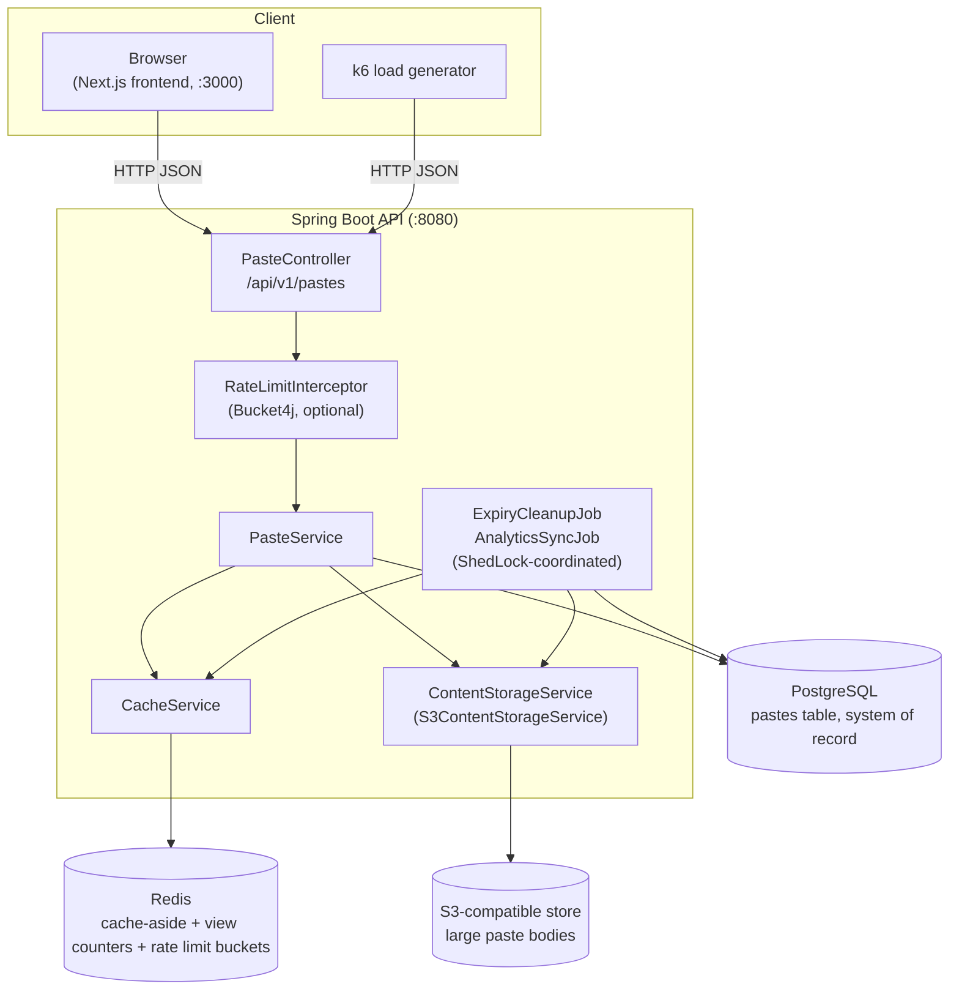

# CuraSnip — Knowledge Transfer Guide

> Repo root: `/Users/meherraju/Projects/CuraSnip` (originally named CuraPaste — the Java package, class names, Docker image labels in some places, and old comments still say `curapaste`; this is a cosmetic rename, not a full refactor — see §9).

This document is a full onboarding walkthrough of the codebase as it exists on disk today. Every claim below is backed by a specific file; where something could not be verified (e.g. production deployment, CI) it is explicitly flagged as **[UNVERIFIED]**.

---

## 1. Big Picture

### What this application does

CuraSnip is a **paste-sharing backend** — a Pastebin-style service where a client `POST`s a block of text and gets back a short, URL-friendly ID; anyone with that ID can retrieve the text via `GET`. Optional features layered on top of the basic flow:

- **Expiry** — a paste can be created with a TTL (`expiresInSeconds`); it stops being servable after that, and a background job physically deletes it.
- **Burn-after-read** — a paste can be configured so the *first* successful read deletes it.
- **Password protection** — a paste can be created with a password; reads must supply the matching password.
- **Creator-only deletion** — paste creation returns a one-time `deleteToken`; only the holder of that token can delete the paste early.
- **View analytics** — every read increments a view counter and "last viewed" timestamp, visible via a metadata endpoint.

### Why it exists (business purpose)

Per `README.md`, this is **explicitly a learning project, not a commercial product**:

> "I built it as a hands-on system design project to go beyond designing systems on paper and actually implement the trade-offs involved in building a **read-heavy backend**... to understand **why** components like Redis, PostgreSQL, object storage, asynchronous processing, resilience patterns, and distributed locking are used."

So the "users" are the project author and anyone reviewing the codebase to learn system-design patterns — not end customers. Keep that in mind when assessing "missing" product features (no UI polish, no auth beyond a delete token, no multi-tenancy) — these are out of scope by design.

### Technology stack (verified from `build.gradle` / `package.json`)

| Layer | Technology | Where |
|---|---|---|
| Backend language/runtime | Java 21, Spring Boot 4.0.6 | `backend/build.gradle` |
| Web framework | Spring MVC (`spring-boot-starter-web`) | `build.gradle` |
| Persistence | Spring Data JPA + Hibernate, PostgreSQL | `build.gradle`, `PasteRepository.java` |
| Migrations | Flyway (`flyway-database-postgresql`) | `backend/src/main/resources/db/migration/` |
| Cache / counters / rate limiting | Redis (Spring Data Redis + Lettuce + Bucket4j) | `CacheService.java`, `RateLimitConfig.java` |
| Object storage | S3-compatible (AWS SDK v2 `software.amazon.awssdk:s3`) — MinIO in the original design, **now `adobe/s3mock` locally** (see §9) | `S3Config.java`, `S3ContentStorageService.java` |
| Distributed locking | ShedLock (JDBC-backed, via Postgres) | `ShedLockConfig.java`, `V7__add_shedlock_lockProvider.sql` |
| Resilience | Resilience4j (circuit breaker + retry) | `CacheService.java`, `S3ContentStorageService.java`, `application.yaml` |
| Metrics | Micrometer + Prometheus registry, exposed via Actuator | `build.gradle`, `application.yaml` |
| Password/token hashing | Spring Security Crypto (`BCryptPasswordEncoder`) | `SecurityUtilConfig.java` |
| Frontend | Next.js 16.3.1 (App Router), React 19.2.8, Tailwind CSS 4 | `frontend/package.json` |
| Load testing | Grafana k6 | `load-testing/test.js` |
| Local infra orchestration | Docker Compose | `backend/docker-compose.yml` |

### High-level architecture



**Read path:** request → Redis cache lookup → on miss, fall back to PostgreSQL → repopulate cache.
**Write path:** request → validate → generate short ID → store content (inline in Postgres if small, else in S3) → write metadata row to Postgres → prime the Redis cache.
**Background:** two scheduled jobs (expiry cleanup, analytics sync) run per-instance but are serialized cluster-wide via ShedLock so multiple app instances don't double-process the same work.

---

## 2. Repository Structure

```
CuraSnip/
├── README.md                      # Project pitch, stack, load-test results
├── Architecture.png                # Hand-drawn architecture diagram (not auto-generated)
├── docs/
│   └── KNOWLEDGE_TRANSFER.md       # This document
├── backend/                        # Spring Boot API — the actual "core" of the project
│   ├── build.gradle                 # Dependency manifest, Java 21 toolchain
│   ├── settings.gradle              # Gradle root project name + toolchain auto-provisioning plugin
│   ├── gradlew / gradlew.bat        # Gradle wrapper (use this, not a system Gradle install)
│   ├── docker-compose.yml           # Local infra: Postgres, Redis, s3mock, pgAdmin, Prometheus, Grafana
│   ├── prometheus.yml               # Prometheus scrape config (targets the app's /actuator/prometheus)
│   ├── body.json                    # Sample request payload for manual testing (not test code)
│   └── src/
│       ├── main/java/com/curapaste/
│       │   ├── CurapasteApplication.java        # Entry point
│       │   ├── config/                           # Spring @Configuration classes
│       │   │   ├── CleanupJobProperties.java       # Binds `cleanup.expiry.*`
│       │   │   ├── RateLimitConfig.java            # Bucket4j + Lettuce beans for rate limiting
│       │   │   ├── SecurityUtilConfig.java         # BCryptPasswordEncoder bean
│       │   │   ├── ShedLockConfig.java             # JDBC-backed distributed lock provider
│       │   │   ├── WebConfig.java                  # Registers the rate-limit interceptor + CORS
│       │   │   └── storage/
│       │   │       ├── S3Config.java                # S3Client bean (path-style, custom endpoint)
│       │   │       └── StorageProperties.java       # Binds `storage.*`
│       │   ├── controllers/
│       │   │   └── PasteController.java          # The only REST controller — all 4 endpoints
│       │   ├── dto/                               # Request/response shapes (Lombok POJOs)
│       │   ├── entities/
│       │   │   └── Paste.java                     # JPA entity mapped to `pastes` table
│       │   ├── interceptor/
│       │   │   └── RateLimitInterceptor.java      # Per-IP POST rate limiting via Bucket4j
│       │   ├── jobs/
│       │   │   ├── AnalyticsSyncJob.java          # Redis → Postgres view-count sync
│       │   │   └── ExpiryCleanupJob.java          # Deletes expired pastes + their S3 objects
│       │   ├── repository/
│       │   │   └── PasteRepository.java           # Spring Data JPA repo with custom @Query methods
│       │   └── services/
│       │       ├── AbuseService.java              # Trivial content-marker check (see §9, dead code)
│       │       ├── CacheService.java               # All Redis interaction lives here
│       │       ├── IdGeneratorService.java         # Random 7-char short ID generator
│       │       ├── PasteService.java               # Core business logic — the heart of the app
│       │       └── storage/
│       │           ├── ContentStorageService.java   # Interface: store/fetch/delete
│       │           └── S3ContentStorageService.java # S3/MinIO/s3mock implementation
│       ├── main/resources/
│       │   ├── application.yaml                   # All runtime configuration
│       │   └── db/migration/                      # Flyway migrations V1, V5, V6, V7 (V2–V4 don't exist — see §9)
│       └── test/java/com/curapaste/
│           └── CurapasteApplicationTests.java     # Single smoke test: does the Spring context load
├── frontend/                       # Thin Next.js UI — NOT the project's focus
│   ├── app/
│   │   ├── layout.tsx                # Root layout, page metadata ("CuraSnip")
│   │   ├── page.tsx                  # Home page: paste-creation form
│   │   ├── globals.css               # Tailwind v4 theme tokens
│   │   └── p/[shortId]/page.tsx     # Dynamic route: view a single paste by ID
│   ├── AGENTS.md / CLAUDE.md          # Notes for AI coding agents about this Next.js version
│   └── package.json                  # Next 16.3.1, React 19.2.8
└── load-testing/
    ├── test.js                       # k6 script: constant-arrival-rate read+write load test
    └── docker-compose.yaml           # Runs k6 against the host's backend (host.docker.internal:8080)
```

**Entry points:**
- Backend: `backend/src/main/java/com/curapaste/CurapasteApplication.java` (`main` method, standard Spring Boot bootstrap).
- Frontend: `frontend/app/page.tsx` (Next.js App Router convention — this file *is* the `/` route).

**Build/dependency manifests:** `backend/build.gradle` (Java deps), `frontend/package.json` (JS deps).

**Config:** `backend/src/main/resources/application.yaml` is the single source of truth for all backend runtime config (DB connection, Redis, storage, cleanup intervals, resilience thresholds, actuator exposure). There are no Spring profiles (`application-dev.yaml`, `application-prod.yaml`, etc.) — **[VERIFIED: only one `application.yaml` file exists]**.

**Tests:** Only one test file exists (`CurapasteApplicationTests.java`), and it only verifies the Spring context loads — there are **no unit tests, no integration tests, no controller tests** for any business logic. This is a real gap — see §9.

**Deployment files:** `backend/docker-compose.yml` provisions *local development* infra (Postgres/Redis/S3-compatible store/monitoring), not a production deployment manifest. There is no Dockerfile for the Spring Boot app itself, no Kubernetes manifests, no CI/CD pipeline config (no `.github/workflows/`, no `Jenkinsfile`) **[VERIFIED: searched repo, none found]**. Packaging/deployment beyond `./gradlew bootRun` on a dev machine is not yet defined anywhere in the repo.

---

## 3. Startup and Execution Flow

### What happens when the backend starts

1. `CurapasteApplication.main()` calls `SpringApplication.run(...)`. The class is annotated:
   - `@SpringBootApplication` — standard component scan + auto-configuration.
   - `@ConfigurationPropertiesScan` — picks up `@ConfigurationProperties` classes (`CleanupJobProperties`, `StorageProperties`) without needing explicit `@EnableConfigurationProperties` on each.
   - `@EnableScheduling` — activates the `@Scheduled` methods in `jobs/`.
   - `@EnableSchedulerLock(defaultLockAtMostFor = "1m")` — wires ShedLock so scheduled jobs are mutually exclusive across instances.
2. Spring Boot auto-configures a `DataSource` from `spring.datasource.*` in `application.yaml`, then **Flyway runs before Hibernate validates the schema** (`spring.flyway.baseline-on-migrate: true`, `baseline-version: 4` — meaning migrations V1 through V4 are assumed already applied/baselined, and only V5+ actually execute as files; see §9 for why V2–V4 are missing from disk).
3. Hibernate's `ddl-auto: validate` means **Hibernate never changes the schema** — it only checks the `Paste` entity's expectations match what Flyway already created. If they mismatch, startup fails loudly rather than silently altering the DB.
4. `ShedLockConfig` registers a `JdbcTemplateLockProvider` backed by the `shedlock` table (created in `V7`).
5. `S3Config` builds an `S3Client` pointed at `storage.endpoint` (path-style addressing forced via `.forcePathStyle(true)`, which is required for MinIO/s3mock but not real AWS S3).
6. `RateLimitConfig` builds a second, independent Redis connection (via Lettuce directly, not through Spring Data Redis) specifically for Bucket4j's distributed bucket state.
7. Tomcat starts on port 8080 (default, not overridden in `application.yaml`).
8. Once the context is up, the two `@Scheduled` jobs begin firing on their configured intervals (`cleanup.expiry.interval-ms`, `analytics-sync.expiry.interval-ms`).

### Request flow #1 — Create a paste (`POST /api/v1/pastes`)

Code: `PasteController.create()` → `PasteService.createPaste()`

1. `RateLimitInterceptor.preHandle()` runs first (registered in `WebConfig` for path `/api/v1/pastes`). If `spring.rate-limit.enabled` is `true` and this is a POST, it consumes 1 token from a per-IP Bucket4j bucket (10 capacity, refills 10/minute, state in Redis). If the bucket is empty, returns `429` immediately — `PasteService` is never reached.
2. `@Valid @RequestBody CreatePasteRequest` — Jakarta Bean Validation enforces `content` is non-blank; `expiresInSeconds` must be positive if present.
3. `PasteService.createPaste()`:
   - Generates a short ID via `IdGeneratorService.generateId()` (7 random chars from a 62-char alphabet), retrying up to 3 times if a collision is found via `pasteRepository.existsByShortId()`. On persistent collision, throws `IllegalStateException` (this is a paging-alert-worthy bug, per the code comment, not a normal retry path).
   - Computes UTF-8 byte size of the content.
   - **Inline-vs-object-storage decision:** if `size > storage.inline-threshold-bytes` (default 50KB, but set to **50 bytes** in `application.yaml` for local testing — see §9), the content goes to S3 (`ContentStorageService.store()`) and only the storage key is saved in Postgres (`content_location` column). Otherwise the raw content is saved directly in the `content` TEXT column.
   - Sets `expiresAt` (now + `expiresInSeconds`, or `null`).
   - If a password was supplied, BCrypt-hashes it into `passwordHash`.
   - Generates a random UUID-based delete token, BCrypt-hashes it into `deleteTokenHash` — **the raw token is never stored**, only returned once in the response.
   - Saves the `Paste` entity (`pasteRepository.save()`) — this is the durability point; if this fails after S3 write succeeded, the `catch` block compensates by deleting the orphaned S3 object (manual saga-style cleanup, not a two-phase commit).
   - Primes the Redis cache (`cacheService.set()`) so the very next read is a cache hit.
   - Returns `CreatePasteResponse` (short ID, content, createdAt, and the **one-time** raw delete token).

### Request flow #2 — Read a paste (`GET /api/v1/pastes/{shortId}`)

Code: `PasteController.getPaste()` → `PasteService.getPaste()`

1. `getCachedPasteOrThrow()` tries `CacheService.get(shortId)` first (Redis `GET paste:{shortId}`, deserialized from JSON). This call is wrapped in `@CircuitBreaker(name = "redisCache", fallbackMethod = "getFallback")` — if Redis is unhealthy (per Resilience4j's sliding-window failure-rate threshold in `application.yaml`), the circuit opens and `getFallback()` returns `Optional.empty()` instead of throwing, which the caller treats as a cache miss.
2. On a true cache miss, falls back to `pasteRepository.findAliveByShortId()` (a JPQL query that also filters out soft-deleted and expired rows at the DB level), converts to `CachedPaste` (fetching the body from S3 via `ContentStorageService.fetch()` if `contentLocation` is set), and re-primes the cache.
3. Expiry check: even if the cached entry was fetched, its `expiresAt` is re-checked against `Instant.now()` — if expired, evicts from cache and returns `404`.
4. Password check: if `passwordHash` is set, requires a matching `password` query param (BCrypt `matches()`); mismatch or absence → `401`.
5. Burn-after-read: if set, this read is a one-shot. `pasteRepository.deleteAliveByShortId()` does an atomic conditional delete (`WHERE shortId = ? AND deletedAt IS NULL`) — the returned row count tells you whether *this* request won the race to consume it. If `0`, someone else already consumed it → `410 Gone`. If `1`, this request proceeds to delete the S3 object (if any), evict the cache, record the view, and return the content exactly once.
6. Otherwise, records the view (increments Redis counter, marks the paste "dirty" for the analytics job) and returns the content.

### Request flow #3 — Background expiry cleanup (`ExpiryCleanupJob.sweep()`)

Code: `jobs/ExpiryCleanupJob.java`, fires every `cleanup.expiry.interval-ms` (15 seconds in current config — see §9 for why that's dev-only).

1. `@SchedulerLock(name = "expiryCleanup", lockAtMostFor = "1m")` — only one app instance runs this at a time, cluster-wide, via the `shedlock` Postgres table.
2. Queries `findExpiredBatch()` — up to `batchSize` (500) rows where `expiresAt <= now` and not already soft-deleted.
3. For each: deletes its S3 object if present, evicts it from Redis.
4. Then **hard-deletes** all of them from Postgres in one batch (`deleteAllInBatch`) — note this is a genuine hard delete, unlike the soft-delete used by the authenticated delete endpoint.

Other flows not detailed above but present in the same two classes: `AnalyticsSyncJob.syncAnalytics()` (periodically flushes Redis-tracked view counts into the `pastes` table, with a double-check against concurrent writes before clearing the "dirty" marker — see code comment at `AnalyticsSyncJob.java:47-51`), and `PasteController.deletePaste()` / `PasteService.deletePaste()` (soft-delete gated by delete-token match).

---

## 4. Major Modules

### `controllers` — `PasteController`

**Responsibility:** the entire public HTTP surface. One controller, four endpoints, all under `/api/v1/pastes`:

| Method | Path | Purpose |
|---|---|---|
| `POST` | `/api/v1/pastes` | Create a paste |
| `GET` | `/api/v1/pastes/{shortId}` | Read a paste (optional `?password=`) |
| `GET` | `/api/v1/pastes/{shortId}/metadata` | Read analytics/metadata without consuming a burn-after-read paste |
| `DELETE` | `/api/v1/pastes/{shortId}` | Delete, given the correct delete token in the request body |

It has zero business logic of its own — every method is a one-line delegation to `PasteService`. Error handling is implicit: `PasteService` throws `ResponseStatusException` with the right HTTP status, and Spring's default exception resolver converts that into the JSON error body. There is no custom `@ControllerAdvice` **[VERIFIED: grepped for `ControllerAdvice`/`ExceptionHandler`, none found]** — this means validation failures (`@Valid`) produce Spring's default, fairly bare error response (confirmed in practice: `{"timestamp":...,"status":400,"error":"Bad Request","path":"..."}` with no field-level detail).

### `services.PasteService`

**Responsibility:** all business logic — the module everything else serves. See §3 for its three main methods (`createPaste`, `getPaste`, `deletePaste`) and the lesser-used `getPasteMetadata`.

**Dependencies:** `PasteRepository` (Postgres), `ContentStorageService` (S3), `StorageProperties` (inline-threshold config), `CacheService` (Redis), `PasswordEncoder` (BCrypt).

**Important implementation decision:** the inline-vs-S3 storage split is a deliberate cost/latency trade-off from the project's system-design framing — small pastes avoid a network round-trip to object storage entirely.

**Error/edge-case handling:**
- Short-ID collision → bounded retries, then a loud `IllegalStateException` (meant to page someone, not be swallowed).
- Expired paste → `404`.
- Wrong/missing password → `401`.
- Already-consumed burn-after-read paste → `410 Gone` (distinguishing "never existed" from "existed but is gone").
- Wrong delete token → `403`.
- Partial failure during create (S3 succeeds, Postgres fails) → compensating delete of the orphaned S3 object, then re-throws.

### `services.CacheService`

**Responsibility:** the only module allowed to talk to the "business" Redis connection (separate from the rate-limiter's Redis connection in `RateLimitConfig`). Wraps:
- Full paste objects (`paste:{shortId}` → JSON blob of `CachedPaste`), with an adaptive TTL (`computeTtl`): never longer than 1 hour, clipped to the paste's actual expiry if sooner, 1 second if already expired.
- View-count and last-viewed-at as separate keys (`paste:{shortId}:views`, `paste:{shortId}:lastViewedAt`), so a hot read path doesn't need to touch the full paste blob just to log a view.
- A `paste:analytics:dirty` Redis **Set** of short IDs that have unsynced view data — this is what `AnalyticsSyncJob` consumes.

**Resilience pattern:** `get()` is wrapped in `@CircuitBreaker` with a fallback that logs and returns empty rather than propagating the Redis failure — callers always get a well-typed `Optional`, never an exception, from a Redis outage. Every other method (`set`, `evict`, `recordView`, etc.) uses manual `try/catch` with `System.out.println` logging instead of the circuit breaker — **inconsistent resilience strategy across the same class**, worth flagging (see §9).

### `services.storage` — `ContentStorageService` / `S3ContentStorageService`

**Responsibility:** abstracts "where large paste bodies live" behind a 3-method interface (`store`, `fetch`, `delete`), with a single S3-API implementation. Storage keys are date-partitioned: `{year}/{month}/{day}/{shortId}.txt` (`buildKey()`), presumably to keep any one "folder" from growing unbounded and to make lifecycle/archival policies easier to reason about later.

**Resilience:** `store()` and `delete()` are circuit-breaker-protected (`objectStorage` breaker, configured in `application.yaml`: opens after 5+ calls with ≥50% failure rate, 10s open state); `delete()` additionally retries up to 3 times with exponential backoff. Both fallback methods surface a `503 Service Unavailable` to the caller rather than a raw SDK exception. **Note:** `fetch()` has no circuit breaker or retry annotation — an asymmetry from `store`/`delete` (see §9).

### `interceptor.RateLimitInterceptor` + `config.RateLimitConfig` + `config.WebConfig`

**Responsibility:** per-IP POST rate limiting, entirely optional via `spring.rate-limit.enabled` (currently `false` in `application.yaml`, explicitly disabled "to load-test locally" per the inline comment). Implementation: Bucket4j backed by a dedicated Lettuce Redis connection (distinct from the one Spring Data Redis manages for `CacheService`), 10 tokens refilling at 10/minute, keyed by `request.getRemoteAddr()`. `WebConfig` also now carries the CORS policy for the frontend (`/api/v1/**` from `http://localhost:3000`) — added during this session's "cosmetic" frontend work, not part of the original design.

### `jobs` — `ExpiryCleanupJob`, `AnalyticsSyncJob`

Covered in §3. Both are ShedLock-coordinated `@Scheduled` methods; both log to stdout rather than a structured logger (`System.out.println`, not SLF4J) — consistent with the rest of the codebase's logging style (see §9).

### `services.AbuseService`

**Responsibility:** checks if paste content contains a hardcoded marker string `[[ABUSE_TEST]]`. **This class is never called from anywhere else in the codebase** — **[VERIFIED: grepped for `AbuseService` usage, only the class definition and its own file match]**. It appears to be a stub/placeholder for a future content-moderation feature, currently dead code.

### `services.IdGeneratorService`

Generates a 7-character ID from a 62-character alphabet (`[A-Za-z0-9]`) using `SecureRandom`. Collision probability is handled by `PasteService`'s retry loop, not by this class — it has no awareness of existing IDs.

---

## 5. Data Layer

### Schema (via Flyway migrations, table `pastes`)

| Column | Type | Added in | Notes |
|---|---|---|---|
| `id` | `BIGSERIAL PRIMARY KEY` | V1 | Internal surrogate key; never exposed via API |
| `content` | `TEXT` (nullable) | V1 | Populated only for inline (small) pastes |
| `short_id` | `VARCHAR(12) UNIQUE NOT NULL` | V1 | The public identifier (actual generated IDs are 7 chars; 12 is headroom) |
| `created_at` | `TIMESTAMPTZ` | V1 | Set by `@PrePersist` in `Paste.java`, not a DB default |
| `content_location` | `VARCHAR(512)` (nullable) | V1 | S3 object key, populated only for large pastes |
| `size_bytes` | `INTEGER NOT NULL` | V1 | UTF-8 byte length of content |
| `expires_at` | `TIMESTAMPTZ` (nullable) | V5 | Partial index `WHERE expires_at IS NOT NULL` for the cleanup job's scan |
| `burn_after_read` | `BOOLEAN NOT NULL DEFAULT FALSE` | V5 | |
| `password_hash` | `VARCHAR(255)` (nullable) | V5 | BCrypt hash, not plaintext |
| `delete_token_hash` | `VARCHAR(255) NOT NULL DEFAULT ''` | V5 | BCrypt hash of the one-time delete token |
| `deleted_at` | `TIMESTAMPTZ` (nullable) | V5 | Soft-delete marker (used by the authenticated delete path, *not* by expiry cleanup, which hard-deletes) |
| `view_count` | `BIGINT NOT NULL DEFAULT 0` | V6 | Periodically synced from Redis, not updated on every read |
| `last_viewed_at` | `TIMESTAMPTZ` (nullable) | V6 | Same sync mechanism |

A second table, `shedlock` (V7), backs the distributed scheduler lock — not part of the domain model, pure infrastructure.

**Migration numbering gap:** files on disk are V1, V5, V6, V7 — **V2, V3, V4 do not exist**, and `application.yaml` sets `flyway.baseline-version: 4`, meaning the schema is assumed to already be at version 4 in any environment this runs against (baseline-on-migrate lets Flyway skip straight to applying V5+ without needing the missing files). **[UNVERIFIED]** what V2–V4 originally contained — they were presumably squashed/removed at some point, or never committed. Anyone needing to stand up a *brand-new* database from scratch should double check this doesn't cause a validation mismatch (empirically, per this session's setup work, migrating from an empty DB did validate cleanly — Flyway treated V1 as if it ran and then treats V5+ as the "next" migrations, which worked in practice but is unusual and worth confirming with whoever removed V2–V4).

### Entity mapping (`entities.Paste`)

Standard JPA `@Entity` with Lombok `@Getter/@Setter/@Builder`. Column names mostly follow Hibernate's default camelCase→snake_case conversion (`shortId`→`short_id` works automatically) except where explicitly annotated (`@Column(name = "...")`) for clarity. `@PrePersist` sets `createdAt` in application code — note this means `createdAt` is **not set** until `.save()` is called, so code must not rely on it before persistence.

### Data access (`PasteRepository`)

Extends `JpaRepository<Paste, Long>`. Beyond inherited CRUD, custom `@Query` (JPQL) methods:
- `findAliveByShortId` — the canonical "give me a usable paste" query (excludes soft-deleted and expired).
- `deleteAliveByShortId` — atomic conditional delete, used specifically for burn-after-read race-safety (see §3, flow #2).
- `softDelete` — sets `deletedAt`, used by the authenticated delete endpoint.
- `findExpiredBatch` — paginated scan for the cleanup job.
- `updateAnalytics` — bulk `UPDATE` for the analytics sync job, scoped by `shortId` + not-deleted.

**Caching/consistency model:** Redis is a **cache-aside** layer, not a source of truth — Postgres is authoritative. View counts are an **eventually consistent** exception to that: they live primarily in Redis and are only periodically flushed to Postgres (by design, to avoid a DB write on every single read — directly the point of this project per the README). This means a direct query against Postgres's `view_count` column can be stale by up to `analytics-sync.expiry.interval-ms` (30 seconds in current config).

---

## 6. APIs and Integrations

### Internal API — `/api/v1/pastes` (see §4 table above for the full list)

- **Authentication:** none in the traditional sense. "Authorization" for destructive actions is a possession-based token: whoever holds the `deleteToken` (returned once at creation) can delete the paste; whoever holds the `password` can read a protected paste. There are no user accounts, sessions, or API keys anywhere in the codebase.
- **Validation:** Jakarta Bean Validation on `CreatePasteRequest` (`@NotBlank` content, `@Positive` expiry) and `DeletePasteRequest` (`@NotBlank` delete token), enforced via `@Valid` in the controller.
- **Error handling:** `ResponseStatusException` thrown from `PasteService` with specific HTTP codes (`404`, `401`, `410`, `403`, `503`); everything else (e.g. bean validation failures) falls through to Spring Boot's default error handler, which returns a generic `{status, error, path, timestamp}` body with no detail message (confirmed: `include-message` is not configured in `application.yaml`, so it defaults to "never").

### External integrations

- **PostgreSQL** — JDBC via HikariCP (Spring Boot default pool), driver `org.postgresql:postgresql`.
- **Redis** — two independent connections: (1) Spring Data Redis's auto-configured `RedisTemplate` (used by `CacheService`), and (2) a manually-built Lettuce connection (used only by `RateLimitConfig`/Bucket4j). They point at the same Redis instance (`spring.data.redis.host/port`) but are wired completely separately in code.
- **S3-compatible object storage** — AWS SDK v2 `S3Client`, pointed at a custom endpoint (`storage.endpoint`) with path-style addressing forced on. This works against MinIO, AWS S3, or any S3-API-compatible service. **As of this session, the locally-running instance is `adobe/s3mock`, not MinIO** — see §9 for why, and note it has no authentication, so `storage.access-key/secret-key` values are currently accepted but functionally ignored by the backing store.
- **Prometheus** — the app exposes `/actuator/prometheus` (enabled via `management.endpoints.web.exposure.include: health,metrics,prometheus`); `backend/prometheus.yml` configures a scrape job named `curasnip` against it. Grafana is provisioned in `docker-compose.yml` as a dashboard layer on top, but **no pre-built Grafana dashboards are checked into the repo** — you'd need to build them manually against the Prometheus datasource.

---

## 7. Frontend and Backend in Detail

### Frontend (`frontend/`)

This is a **thin demo UI**, not the project's focus (per README: "Frontend — Yet to be implemented in Next.js" was the original state; a basic working UI was added during this session).

- **Routing:** Next.js App Router, two routes:
  - `/` (`app/page.tsx`) — a client component (`"use client"`) with a controlled textarea + burn-after-read checkbox, `fetch()`-posts to the backend, and on success shows a link to the view page plus the one-time delete token.
  - `/p/[shortId]` (`app/p/[shortId]/page.tsx`) — a client component that reads the dynamic segment via `useParams()`, fetches the paste on mount (`useEffect`), and renders content in a `<pre>` block, or a friendly message for 404/expired/burned pastes.
- **State management:** plain `useState`/`useEffect`, no external state library — appropriate given there are only two pages and no shared state between them.
- **Data fetching:** direct `fetch()` calls from the browser straight to the backend (`http://localhost:8080/api/v1/pastes`, overridable via `NEXT_PUBLIC_API_BASE`). No API routes/proxy layer inside Next.js itself — this is why CORS had to be enabled on the backend (`WebConfig.addCorsMappings`).
- **Styling:** Tailwind CSS v4, no component library, light/dark mode via `prefers-color-scheme` media query in `globals.css`.
- **Known gaps:** no password-prompt UI for password-protected pastes (API supports it; frontend doesn't expose it), no delete UI (API supports deletion via token; frontend never shows a delete button), no copy-to-clipboard, no loading skeletons beyond a plain "Loading..." text.

### Backend (`backend/`)

Covered exhaustively in §3–§6. Key structural pattern: **Controller → Service → (Repository | CacheService | ContentStorageService)**, a clean three-layer architecture. No separate "DTO mapper" layer — `PasteService` manually constructs DTOs inline (e.g. `toCachedPaste()`), which is fine at this scale but would need extraction if the number of DTOs grew.

---

## 8. Working With the Project

> Everything in this section was executed and verified during this session unless marked **[UNVERIFIED]**.

### Prerequisites

- Docker (Docker Desktop on macOS — note the `docker` CLI and `docker-credential-desktop` binaries live under `/Applications/Docker.app/Contents/Resources/bin`, which may not be on `$PATH` by default; add it or invoke binaries by full path).
- No local JDK 21 or Gradle install is required — `backend/settings.gradle` includes the `foojay-resolver-convention` plugin (added this session), so `./gradlew` auto-downloads a JDK 21 toolchain on first run. **Caveat:** the resolver plugin version matters — version `0.8.0` is incompatible with Gradle 9.x (throws `NoSuchFieldError: IBM_SEMERU`); this repo pins `1.0.0`, which works.
- Node.js + npm for the frontend (version not pinned anywhere in the repo — **[UNVERIFIED]** minimum version, but Next.js 16 + React 19 implies a recent Node LTS).

### Local infrastructure caveat: MinIO is gone

The original `docker-compose.yml` used `minio/minio:latest`. **As of 2025, MinIO Inc. pulled their images from Docker Hub** (and `bitnami/minio` is also gone) as part of a licensing change — pulling either now fails with "pull access denied... repository does not exist." This repo's `docker-compose.yml` has been updated to use **`adobe/s3mock`** instead, which speaks the same S3 API on port 9090 (mapped to host 9000 to keep the rest of the config unchanged). Differences from real MinIO to be aware of:
- No authentication — `MINIO_ROOT_USER/PASSWORD` env vars are present in the compose file but not enforced by s3mock.
- No web console (MinIO's port 9001 is gone).
- **No bucket auto-creation** — you must `curl -X PUT http://localhost:9000/<bucket-name>` once after starting the container, or the backend's first large-paste write will fail. (The bucket name is whatever `storage.bucket` is set to in `application.yaml` — currently `curasnip-content`.)

### Steps to run locally

1. **Start infra:**
   ```bash
   cd backend
   docker compose up -d postgres redis minio pgadmin
   ```
   (Prometheus/Grafana are also defined in the compose file but may fail to bind if port 9090 is already in use by something else on your machine — this is optional monitoring, not required for the API to function. Start them separately with `docker compose up -d prometheus grafana` once the port is free.)

2. **Create the storage bucket** (one-time, or after a fresh volume):
   ```bash
   curl -X PUT http://localhost:9000/curasnip-content
   ```

3. **Run the backend:**
   ```bash
   cd backend
   chmod +x gradlew   # if not already executable
   ./gradlew bootRun
   ```
   First run downloads a JDK 21 toolchain and all Gradle dependencies — expect this to take a few minutes. Subsequent runs are much faster (Gradle daemon + dependency cache).

4. **Verify the backend:**
   ```bash
   curl http://localhost:8080/actuator/health
   # → {"groups":["liveness","readiness"],"status":"UP"}

   curl -X POST http://localhost:8080/api/v1/pastes \
     -H "Content-Type: application/json" \
     -d '{"content":"hello world","burnAfterRead":false}'
   # → {"shortId":"...", "content":"hello world", "createdAt":"...", "deleteToken":"..."}
   ```
   **Gotcha verified this session:** omitting `burnAfterRead` from the JSON body used to cause a `400` (Jackson tried to bind `null` into a primitive `boolean` via a Lombok `@AllArgsConstructor` that shadowed the intended no-arg-constructor-plus-setters binding). This has been **fixed** by removing the unused `@AllArgsConstructor` from `CreatePasteRequest` — current behavior correctly defaults `burnAfterRead` to `false` when omitted. If you see this error reappear, check whether a similar `@AllArgsConstructor` + primitive-field combination has been reintroduced in another DTO (checked `DeletePasteRequest` — it has the same constructor combo but no primitive fields, so it's *not* affected).

5. **Run the frontend:**
   ```bash
   cd frontend
   npm install
   npm run dev
   ```
   Open `http://localhost:3000`. Requires the backend to be running and CORS-enabled for `http://localhost:3000` (already configured in `WebConfig.java`).

### Running tests

```bash
cd backend
./gradlew test
```
**[VERIFIED structurally, not re-run this session]** — there is exactly one test (`contextLoads`), so a green result only proves the Spring context wires up, not that any business logic is correct.

Frontend: `npm run lint` (ESLint, config in `frontend/eslint.config.mjs`). **No frontend test runner is configured** — no Jest/Vitest/Playwright setup exists.

### Build commands

- Backend: `./gradlew build` (compiles + runs tests + packages a jar under `backend/build/libs/`).
- Frontend: `npm run build` (Next.js production build) / `npm run start` (serve the production build).

### Debugging common problems

| Symptom | Likely cause | Where to look |
|---|---|---|
| `400 Bad Request` on paste creation with no detail | A DTO field being omitted that Jackson can't null-bind to a primitive | Check for `@AllArgsConstructor` + primitive fields in the relevant DTO |
| Backend fails to start with a Flyway validation error | Local DB has a different migration history than V1/V5/V6/V7 expects | Check `flyway.baseline-version` and whether the DB was ever on an intermediate schema |
| `503` on reads/writes under load | Resilience4j circuit breaker has opened (Redis or S3 unhealthy) | Check `backend/.../application.yaml` → `resilience4j.circuitbreaker.instances.*` thresholds; check actual Redis/S3 container health |
| Large paste creation fails with a bucket-not-found-style S3 error | s3mock bucket was never created, or container was recreated with a fresh volume | Re-run the `PUT` bucket-creation curl command |
| CORS error in browser console | Frontend origin doesn't match `WebConfig`'s allowed origin, or frontend isn't on port 3000 | `WebConfig.addCorsMappings()` |
| Gradle build fails with `NoSuchFieldError: IBM_SEMERU` | Wrong foojay-resolver-convention plugin version for the installed Gradle version | Ensure `settings.gradle` pins `1.0.0`, not `0.8.0` |

### Deployment process

**[UNVERIFIED / NOT YET DEFINED]** — there is no Dockerfile for the application itself, no CI pipeline, and no production deployment documentation anywhere in the repo as of this writing. The `docker-compose.yml` is explicitly a *local development* convenience, not a deployment artifact (it exposes default/throwaway credentials like `pastebin`/`pastebin` and `minio`/`minio123` directly in plaintext, which would need to move to secrets management before any real deployment).

---

## 9. Important Technical Considerations

### Architectural patterns in use
- **Cache-aside** (Redis in front of Postgres for reads).
- **Compensating action / manual saga** on create failure (delete orphaned S3 object if the Postgres write fails after S3 succeeded) — not a true distributed transaction, just best-effort cleanup.
- **Circuit breaker + retry** (Resilience4j) around the two external dependencies most likely to fail under load: Redis and object storage.
- **Distributed locking** (ShedLock) to make `@Scheduled` jobs safe to run on more than one instance.
- **Optimistic dirty-tracking** for analytics sync — `AnalyticsSyncJob` double-checks Redis state hasn't changed again before clearing the "synced" marker, to avoid losing a concurrent view that arrived mid-sync.

### Known limitations / technical debt (confirmed issues)

1. **No tests beyond a context-load smoke test.** Any business-logic regression (expiry, burn-after-read races, password checks, delete-token checks) has zero automated coverage.
2. **No custom exception handling (`@ControllerAdvice`).** Validation errors return Spring's bare default error body with no actionable detail for API consumers.
3. **Dead code:** `AbuseService` is never invoked from anywhere.
4. **Inconsistent resilience annotations:** `CacheService.get()` has a circuit breaker; `set/evict/recordView/getViewCount/getLastViewedAt/getDirtyPasteIds/markAnalyticsSynced` rely on manual try/catch only. `S3ContentStorageService.fetch()` has neither circuit breaker nor retry, while `store()` and `delete()` have both — an asymmetry that means a flaky object store could make reads of large pastes throw raw SDK exceptions instead of a clean `503`.
5. **Logging is all `System.out.println`/`System.err.println`**, not SLF4J/Logback despite Logback being on the classpath transitively via Spring Boot. No log levels, no structured logging, no easy way to filter noise in production.
6. **Dev-tuned config values are currently the defaults**, not overridden per-environment: `cleanup.expiry.interval-ms: 15000` (15s, vs. the commented "300000 (5min) for prod"), `storage.inline-threshold-bytes: 50` (50 **bytes**, vs. the commented "51200 (50kb) for prod"), `spring.rate-limit.enabled: false`. There is no Spring profile mechanism to switch these automatically — someone deploying this would need to manually edit `application.yaml` or override via environment variables/command-line flags.
7. **Flyway migration gap (V2–V4 missing)** — see §5. Works in practice against a fresh DB due to `baseline-on-migrate`, but is unusual and should be understood (not just trusted) before relying on it in a new environment.
8. **No authentication/authorization beyond possession of a token** — acceptable for a learning project, a hard blocker for anything handling real user data.
9. **Secrets are hardcoded in `docker-compose.yml` and `application.yaml`** (DB password, MinIO/s3mock keys) — fine for local dev, unsafe to deploy as-is.

### Naming/branding inconsistency (this session's changes)

The project was renamed from **CuraPaste** to **CuraSnip** mid-session, but only at the "branding" layer:
- Updated: `README.md`, frontend page title/heading, `docker-compose.yml` (project name, container names, network name), `settings.gradle` (Gradle root project name), `application.yaml` (`spring.application.name`, S3 bucket name), `prometheus.yml` (scrape job name), `load-testing/docker-compose.yaml`.
- **Not updated (deliberately, as a scoping decision):** the Java package is still `com.curapaste.*` across every backend source file, the main class is still `CurapasteApplication`, the test class is still `CurapasteApplicationTests`, and the repo's root folder is still named `CuraPaste-main` → now `CuraSnip` (it was renamed since this document references the new path, but check whether that was a manual OS-level rename or something else — **[UNVERIFIED]** exactly how/when the folder path changed between sessions). A full rename (Java package + class names) would touch every backend source file's `package` declaration and imports — a much larger, riskier change than was requested ("cosmetic... core should be same").

### S3 provider substitution (this session's changes)

Original design assumed MinIO (per README's tech stack table). Locally, this repo now runs `adobe/s3mock` instead, because MinIO's Docker images were pulled from Docker Hub in 2025. This is functionally equivalent for this app's purposes (same S3 API surface used: `PutObject`, `GetObject`, `DeleteObject`), but:
- Loses MinIO's web console.
- Loses MinIO's actual auth enforcement (s3mock accepts any credentials).
- Requires manual bucket creation (MinIO in auto-create mode might have been configured differently — **[UNVERIFIED]** whether the original MinIO setup auto-created the bucket, since no bucket-creation code exists anywhere in the Java source either way).
- **If deploying to real AWS S3 or a still-available MinIO instance later, `docker-compose.yml`'s `minio` service definition would need to be swapped back or pointed at the real service — the Java code itself (`S3Config`, `S3ContentStorageService`) requires no changes either way, since it only depends on `storage.endpoint/access-key/secret-key/bucket/region` being correctly set.**

### Testing strategy assessment

There effectively is no testing strategy beyond "does the app start." Given the amount of concurrency-sensitive logic (burn-after-read's atomic conditional delete, the analytics job's dirty-flag double-check, ID-generation collision retry), this is the single highest-value gap to close before trusting this code under real load or during a refactor.

### Areas requiring extra care

- Any change to `PasteService.getPaste()`'s burn-after-read branch — the atomicity of `deleteAliveByShortId()` is the only thing preventing a paste from being served twice under concurrent reads. Don't refactor this into a read-then-delete without re-deriving the atomicity argument.
- Any change to `CacheService`'s TTL computation (`computeTtl`) — getting this wrong could either cache an expired paste past its real expiry, or thrash Redis with 1-second TTLs for pastes that aren't actually about to expire.
- `storage.inline-threshold-bytes` — currently 50 bytes (testing value), meaning almost everything goes to S3 locally. Don't mistake this for production behavior when reasoning about latency.

---

## 10. Knowledge-Transfer Summary

### Concise project overview

CuraSnip is a single-service Spring Boot paste-sharing API with a thin Next.js demo frontend, built as a hands-on exploration of read-heavy backend system design (cache-aside, hybrid storage, eventual-consistency analytics, resilience patterns, distributed job locking) rather than as a production product.

### Component-by-component architecture summary

- **PasteController** — HTTP surface, zero logic.
- **PasteService** — all business rules (create/read/delete/metadata), owns the inline-vs-S3 decision and all status-code semantics.
- **CacheService** — sole owner of the "business" Redis connection; cache-aside + view-count tracking + dirty-set for async sync.
- **S3ContentStorageService** — sole owner of large-paste bodies in object storage, resilience-wrapped.
- **PasteRepository** — Postgres access, including the atomicity-critical conditional queries.
- **ExpiryCleanupJob / AnalyticsSyncJob** — ShedLock-coordinated background maintenance.
- **RateLimitInterceptor** — optional, currently-disabled per-IP throttling, on its own Redis connection.
- **Frontend** — two pages, directly calling the backend, no intermediate API layer.

### Glossary

| Term | Meaning |
|---|---|
| Short ID | The 7-character public identifier for a paste (e.g. `wmIiJke`) |
| Burn-after-read | A paste that deletes itself the first time it's successfully read |
| Delete token | A one-time secret returned at creation; required to delete the paste early |
| Inline storage | Storing a paste's content directly in the Postgres `content` column (for small pastes) |
| Content location | The S3 object key, stored in Postgres, pointing to a paste's body when it's *not* inline |
| Cache-aside | Pattern where the app checks cache first, falls back to DB on miss, then repopulates cache |
| Dirty paste (analytics) | A paste whose view count/last-viewed-at has changed in Redis but not yet been flushed to Postgres |
| ShedLock | Library providing a DB-backed mutex so `@Scheduled` jobs don't double-run across instances |
| s3mock | Adobe's lightweight S3-API-compatible test double, standing in for MinIO in local dev (see §9) |

### 10–15 most important files to study first

1. `backend/src/main/java/com/curapaste/services/PasteService.java` — the heart of the application; read this first, in full.
2. `backend/src/main/java/com/curapaste/controllers/PasteController.java` — the API surface; quick, confirms what PasteService is called for.
3. `backend/src/main/java/com/curapaste/entities/Paste.java` — the data model.
4. `backend/src/main/java/com/curapaste/repository/PasteRepository.java` — especially the custom JPQL queries; these encode subtle correctness guarantees (atomicity, soft-delete filtering).
5. `backend/src/main/java/com/curapaste/services/CacheService.java` — second-most logic-dense file; explains the Redis data model.
6. `backend/src/main/resources/application.yaml` — every tunable in the system lives here.
7. `backend/src/main/resources/db/migration/*.sql` (all four) — the schema's actual history, and the thing to reconcile against `baseline-version`.
8. `backend/src/main/java/com/curapaste/jobs/ExpiryCleanupJob.java` and `AnalyticsSyncJob.java` — background behavior that's easy to forget exists.
9. `backend/src/main/java/com/curapaste/services/storage/S3ContentStorageService.java` — object storage integration + resilience pattern reference.
10. `backend/src/main/java/com/curapaste/config/WebConfig.java` — rate limiting + CORS wiring (small, but ties several concerns together).
11. `backend/docker-compose.yml` — local infra topology; read alongside §9's MinIO→s3mock note.
12. `backend/build.gradle` — confirms exact dependency versions and the Java 21 toolchain requirement.
13. `frontend/app/page.tsx` and `frontend/app/p/[shortId]/page.tsx` — the entire frontend; both are short.
14. `README.md` — the project's own framing of its goals; essential context for *why* things are built the way they are.
15. `load-testing/test.js` — shows the expected real-world traffic shape (1200 reads/s : 12 writes/s) that motivated several design choices.

### Suggested first-week learning plan

- **Day 1:** Read README.md + this document in full. Get local infra running (docker compose + bucket creation) and the backend booting successfully. Confirm `/actuator/health` returns `UP`.
- **Day 2:** Trace the create-paste flow end-to-end in the debugger: `PasteController.create()` → `PasteService.createPaste()` → watch it hit both the inline path (small content) and the S3 path (content over 50 bytes, given current test config).
- **Day 3:** Trace the read-paste flow, paying special attention to the burn-after-read branch and `deleteAliveByShortId()`'s atomicity. Try to break it with concurrent `curl` requests.
- **Day 4:** Read `CacheService` fully; manually inspect Redis keys with `redis-cli` while creating/reading pastes to see the cache-aside pattern live.
- **Day 5:** Read both background jobs; temporarily lower their intervals further and watch them fire in the logs. Read the ShedLock table (`shedlock`) directly in Postgres to see the lock rows appear/disappear.

### Five realistic starter tasks

1. **Add a unit test for `PasteService.createPaste()`'s short-ID collision retry logic** (mock `PasteRepository.existsByShortId()` to return `true` for N attempts, verify it retries exactly `MAX_ID_RETRIES` times then throws `IllegalStateException`). Low-risk, high learning value — forces reading the retry loop carefully.
2. **Replace `System.out.println`/`System.err.println` with SLF4J logging** across `CacheService`, the two jobs, and `S3ContentStorageService`. Mechanical but touches every important file, a good way to read the whole codebase.
3. **Add a `@ControllerAdvice` to return field-level validation error messages** instead of Spring's bare default error body — directly improves API usability and is scoped to one new file.
4. **Wrap `S3ContentStorageService.fetch()` in a circuit breaker + fallback**, matching the pattern already used for `store()`/`delete()`, to close the asymmetry noted in §9.
5. **Delete the unused `AbuseService`**, or wire it into `PasteService.createPaste()` behind a config flag if content moderation is actually wanted — either way, resolve the dead-code ambiguity.

### Questions to ask the existing team / project owner

- Were V2–V4 migrations ever real, or was `baseline-version: 4` chosen for a different reason (e.g. copying a convention from elsewhere)? Does a fresh environment truly need no changes, or is this untested beyond this session's one verification?
- Is `AbuseService` planned for future wiring, or safe to delete?
- Is there an intended target deployment environment (a specific cloud provider, a specific VPS, a PaaS)? This materially changes how object storage (real S3 vs. self-hosted MinIO vs. s3mock-forever) and secrets management should be set up — this was an open, unresolved question as of this document's writing.
- Should the frontend remain a thin demo, or is a real UI (password-prompt flow, delete button, copy-to-clipboard, etc.) in scope?
- What's the intended testing strategy going forward — is `./gradlew test` expected to grow real coverage, or is manual/k6 testing considered sufficient for this project's learning goals?

---

*Document generated from direct repository inspection. No file contents were assumed or fabricated; every code claim above traces to a specific file read during this session. Deployment/production topics are marked **[UNVERIFIED]** because no such configuration exists in the repository as of this writing.*
